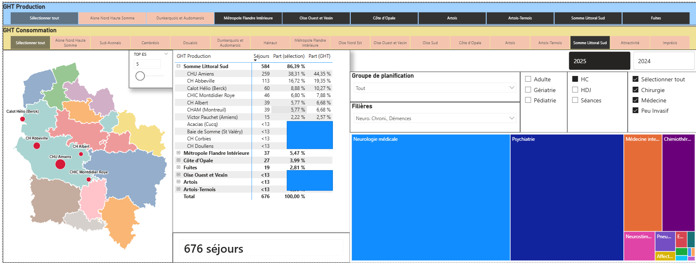

# Consommation production par GHT en HDF

## Description

Cet outil à destination des DIM de territoire est à utiliser à l'intérieur de la bulle de données AITH Data Expert.

## Éléments

- Un package [`atihdf`](https://github.com/pietrodito/atihdf) à installer sur RStudio au sein de la plateforme ATIH
- Un projet RStudio [Conso Prod par filières](https://github.com/pietrodito/conso_prod_filieres) à exécuter sur la plateforme RStudio après installation du package
- Un modèle de rapport Power BI `.pbit` disponible dans ce dépôt qui permet ensuite de visualiser l'extraction du projet filières ci-dessus

## Documentation

Une fiche de lecture de l'outil (schéma d'ensemble, dépendances, traitement R, fichier produit, rapport Power BI, mode d'emploi, limites) est disponible dans [`docs/fiche_outil_conso_prod_ght_hdf.html`](./docs/fiche_outil_conso_prod_ght_hdf.html) : page HTML autonome, à télécharger puis ouvrir dans un navigateur.

## Visuel du rapport

